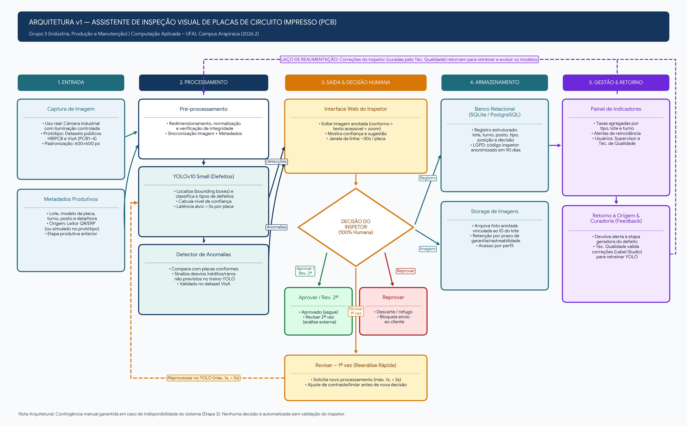
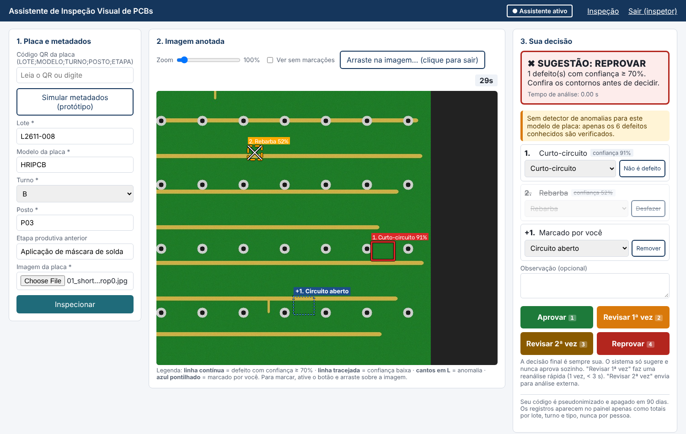
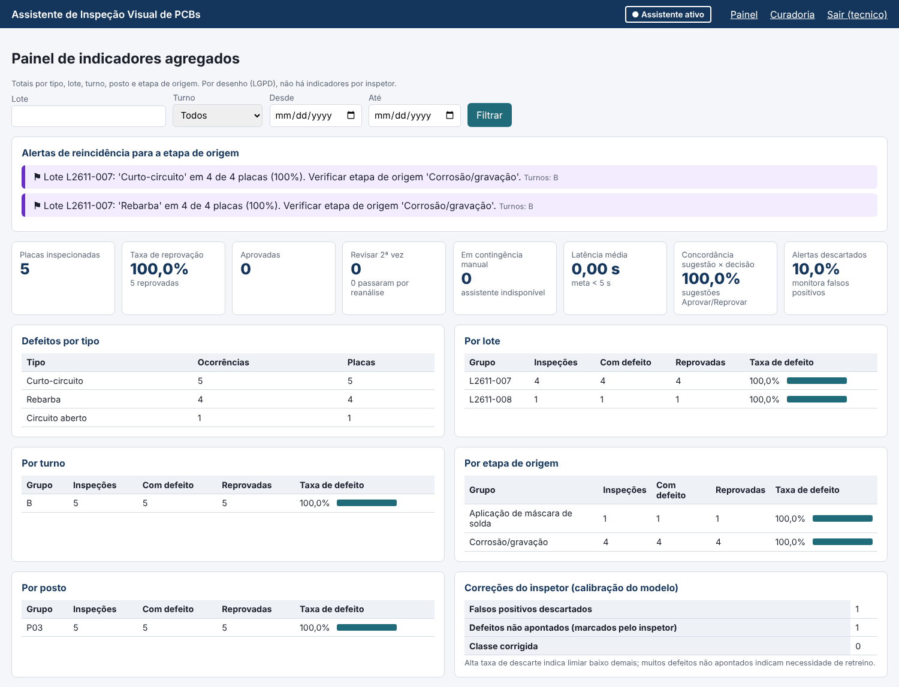
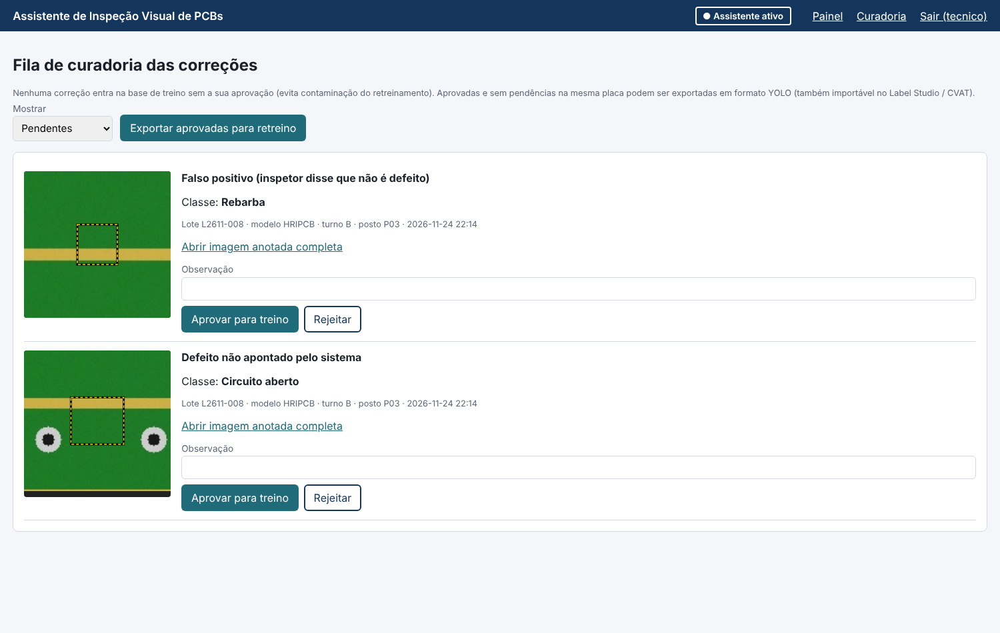

# Assistente de Inspeção Visual com Registro Estruturado de Defeitos em PCBs

**Grupo 3 · Indústria, Produção e Manutenção**
João Vitor Gomes, Washington Medeiros, Mikael, Matheus Jose, Leoni de Padua e Wagner Batista
Tópicos Aplicados à Computação Aplicada · Prof.ª Raquel da Silva Cabral · UFAL Campus Arapiraca · 2026.2

Protótipo da **Arquitetura v1** descrita no documento *Projeto Final – Primeira Versão Integrada (Etapas 1 a 4)*.

> **Problema.** Placas com defeitos visuais escapam da inspeção porque o inspetor tem cerca de 30 s por unidade, sob ritmo contínuo e por amostragem. Além disso, o defeito encontrado raramente é registrado de forma estruturada ou devolvido à etapa que o originou.
>
> **Solução.** Um assistente que **aponta onde olhar** (YOLO para 6 defeitos conhecidos e detector de anomalias para desvios inéditos) enquanto **o inspetor decide** sozinho. Cada inspeção vira um **registro rastreável** (lote, turno, posto, tipo, posição, decisão), que alimenta um **painel agregado** com alertas de reincidência para a etapa de origem. As correções do inspetor passam pela **curadoria** do Técnico de Qualidade e voltam para o retreino.



---

## 1. Da arquitetura ao código

| Bloco da Figura 1 | Componente | Arquivo |
|---|---|---|
| 1. Entrada | Captura (upload; HRIPCB/VisA no protótipo), padronização 600×600 | `app/preprocess.py` |
| 1. Entrada | Metadados produtivos: QR `LOTE;MODELO;TURNO;POSTO;ETAPA` ou simulados | `app/metadata.py` |
| 2. Processamento | Pré-processamento: redimensionamento, normalização e integridade | `app/preprocess.py` |
| 2. Processamento | Detector de defeitos conhecidos (YOLO, 6 classes, confiança) + inferência em blocos | `app/detector.py` |
| 2. Processamento | Detector de anomalias (treinado só com placas conformes) | `app/anomaly.py` |
| 3. Saída & Decisão Humana | Regra de sugestão Aprovar / Revisar / Reprovar (nunca decide sozinho) | `app/suggestion.py` |
| 3. Saída & Decisão Humana | Imagem anotada acessível (contorno + texto, nunca só cor) | `app/annotate.py` |
| 3. Saída & Decisão Humana | Interface Web do Inspetor: zoom, decisões, correções, cronômetro de 30 s | `app/templates/inspetor.html`, `app/static/inspetor.js` |
| 3. Saída & Decisão Humana | "Revisar – 1ª vez": reanálise máx. 1x, < 3 s | `app/service.py` → `reprocessar()` |
| 4. Armazenamento | Banco relacional (SQLite; PostgreSQL em fábrica) | `app/db.py` |
| 4. Armazenamento | Storage de imagens com ID único, gravado antes do commit | `app/storage.py` |
| 4. Armazenamento | LGPD: pseudônimo HMAC, anonimização em 90 dias | `app/lgpd.py`, `scripts/anonimizar.py` |
| 5. Gestão & Retorno | Painel agregado (sem visão por inspetor) e alertas de reincidência | `app/dashboard.py`, `/painel` |
| 5. Gestão & Retorno | Curadoria do Técnico e exportação YOLO para retreino | `app/curation.py`, `/curadoria` |
| Laço de realimentação | Retreino com as correções curadas | `scripts/treinar_yolo.py` |

| Inspetor | Painel | Curadoria |
|---|---|---|
|  |  |  |

*Telas capturadas com placas sintéticas e um detector simulado, só para ilustrar a interface.*

O mapeamento completo entre cada seção do documento e o código está em [`docs/rastreabilidade.md`](docs/rastreabilidade.md).

## 2. Como executar

Requisitos: Python 3.10 ou superior.

```bash
pip install -r requirements.txt          # interface, banco, anomalias
pip install -r requirements-ml.txt       # YOLO (Ultralytics + PyTorch)
uvicorn app.main:app --reload            # http://localhost:8000
```

| Perfil | Acesso | Login |
|---|---|---|
| Inspetor de Qualidade | Tela de inspeção | código funcional (ex.: `INSP-07`), nunca nome |
| Supervisor de Produção | Painel | PIN (`PCB_PIN_SUPERVISOR`, padrão `1234`) |
| Técnico de Qualidade | Painel e curadoria | PIN (`PCB_PIN_TECNICO`, padrão `4321`) |

**Sem o modelo treinado** (`modelos/yolo_pcb.pt`), a aplicação abre em **modo contingência**. O inspetor faz a inspeção manual e a decisão continua sendo registrada, então a linha não para (Seção 12, risco "indisponibilidade").

Variáveis principais (todas em `app/config.py`):

| Variável | Padrão | Origem no documento |
|---|---|---|
| `PCB_LIMIAR_REVISAR` | `0.70` | 9.1: corte abaixo do qual a sugestão é "Revisar" |
| `PCB_REPROC_MODO` | `ambos` | 9.1: reanálise por `contraste`, `limiar` ou `ambos` |
| `PCB_PESOS_YOLO` | `modelos/yolo_pcb.pt` | 9.1: variante do YOLO (qualquer peso Ultralytics) |
| `PCB_PASTA_ANOMALIA` | `modelos/anomalia/` | 9.1: anomalias na mesma tela (ativo quando existe `<modelo>.npz`) |
| `PCB_MODELOS_VALIDADOS` | vazio | Seção 12: avisa uso fora do modelo de placa validado |
| `PCB_DIAS_ANONIMIZACAO` | `90` | Seção 5: LGPD, art. 16 |
| `PCB_SEGREDO`, `PCB_CHAVE_SESSAO` | — | **troque em produção** |

## 3. Pipeline com os dados reais (Seção 5)

Os conjuntos públicos não estão no repositório por causa do tamanho e das licenças. Baixe:

* **HRIPCB** (Huang; Wei, 2019): 1.386 placas inteiras com anotações VOC.
* **Conjunto ampliado de 10.668 imagens 600×600** usado por Mitoso e Melo (2025), derivado do HRIPCB (Ding et al., 2019).
* **VisA** (Zou et al., 2022): categorias `pcb1` a `pcb4`.

```bash
# 1) VOC → YOLO
python scripts/converter_voc_para_yolo.py --imagens HRIPCB/images  --anotacoes HRIPCB/Annotations  --saida datasets/hripcb_yolo
python scripts/converter_voc_para_yolo.py --imagens AMPLIADO/images --anotacoes AMPLIADO/Annotations --saida datasets/ampliado_yolo

# 2) Divisão POR PLACA (recortes derivados das placas de teste saem do treino → sem vazamento)
python scripts/dividir_por_placa.py --treino datasets/ampliado_yolo --teste datasets/hripcb_yolo --saida datasets/pcb

# 3) Treino (variante = decisão aberta 9.1)
python scripts/treinar_yolo.py --dados datasets/pcb/pcb.yaml --modelo yolov10s.pt --epocas 100 --dispositivo 0

# 4) Detector de anomalias (placas conformes do VisA)
python scripts/ajustar_anomalias.py --visa datasets/VisA --categorias pcb1 pcb2 pcb3 pcb4
```

## 4. Avaliação (Seções 10 e 11)

| Aspecto (Seção 10) | Script | Critério (Seção 11) |
|---|---|---|
| 1. Desempenho técnico: recall, precisão, mAP@50 e mAP@50:95 por classe | `scripts/avaliar_deteccao.py` | C1 recall ≥ 90% · C2 precisão ≥ 70% |
| 2. Robustez: ruído gaussiano e sal e pimenta (0,02, protocolo de Dias et al.) | `scripts/avaliar_robustez.py` | — |
| 2. Anomalias: AUROC, taxa de detecção e falso alarme no VisA PCB1–4 | `scripts/avaliar_anomalias.py` | — |
| 3. Latência ponta a ponta | `scripts/medir_latencia.py` | C3 média < 5 s |
| 4. Escape humano com e sem assistente | `scripts/teste_humano/*` + `/teste/<sessão>` | C4 |
| 5. Viés de automação e usabilidade (1 a 5) | `scripts/teste_humano/*` | C5 |
| 6. Rastreabilidade do registro | `scripts/auditar_rastreabilidade.py` | % de inspeções completas |

```bash
python scripts/avaliar_deteccao.py  --imagens datasets/pcb/test/images --rotulos datasets/pcb/test/labels
python scripts/avaliar_robustez.py  --imagens datasets/pcb/test/images --rotulos datasets/pcb/test/labels
python scripts/avaliar_anomalias.py --visa datasets/VisA
python scripts/medir_latencia.py    --imagens datasets/pcb/test/images --n 50
python scripts/auditar_rastreabilidade.py
```

Os resultados ficam em `resultados/*.json`.

### Teste controlado com voluntários

O protocolo está em [`docs/protocolo_teste_voluntarios.md`](docs/protocolo_teste_voluntarios.md): 20 placas, 10 sem e 10 com assistente, até 30 s por placa, contrabalanceamento A/B e 1 a 2 sugestões erradas propositais.

```bash
python scripts/teste_humano/gerar_sessao.py --imagens datasets/pcb/test/images --rotulos datasets/pcb/test/labels --sessao S1
# entrar como Técnico → http://localhost:8000/teste/S1 → participante V01, V02, ...
python scripts/teste_humano/analisar_resultados.py --sessao S1
```

## 5. Ensaio rápido sem baixar datasets

`scripts/demo/gerar_dados_sinteticos.py` cria placas **sintéticas** no formato do HRIPCB para testar o pipeline de ponta a ponta. **Métricas obtidas com esses dados não são resultados do projeto.**

```bash
python scripts/demo/gerar_dados_sinteticos.py --saida datasets/sintetico
python scripts/converter_voc_para_yolo.py --imagens datasets/sintetico/inteiras/images  --anotacoes datasets/sintetico/inteiras/Annotations  --saida datasets/sintetico/yolo_inteiras
python scripts/converter_voc_para_yolo.py --imagens datasets/sintetico/recortes/images  --anotacoes datasets/sintetico/recortes/Annotations  --saida datasets/sintetico/yolo_recortes
python scripts/dividir_por_placa.py --treino datasets/sintetico/yolo_recortes --teste datasets/sintetico/yolo_inteiras --saida datasets/sintetico/pcb
python scripts/treinar_yolo.py --dados datasets/sintetico/pcb/pcb.yaml --modelo yolov8n.yaml --epocas 30 --dispositivo cpu
python scripts/ajustar_anomalias.py --pasta-normais datasets/sintetico/normais --modelo-placa SINTETICA
```

## 6. Garantias de projeto (Seção 12) e onde são testadas

| Risco | Mitigação implementada | Teste |
|---|---|---|
| Falso negativo | O sistema só sugere; a decisão é sempre do inspetor; "Aprovar" com marcações pede confirmação | `test_inspecao_registra_e_nao_decide_sozinho` |
| Falso positivo | Limiar configurável e taxa de "alertas descartados" no painel | `test_decisao_gera_correcoes_e_e_imutavel` |
| Uso fora do contexto | `PCB_MODELOS_VALIDADOS` gera aviso de inspeção manual completa | `test_fora_do_contexto` |
| Viés de automação | Localização e confiança visíveis; erros propositais no teste | `test_sessao_ponta_a_ponta` |
| Privacidade e vigilância | Pseudônimo HMAC, anonimização em 90 dias, painel sem consulta por pessoa | `test_anonimizacao_90_dias`, `test_painel_sem_inspetor_…` |
| Indisponibilidade | Modo contingência manual | `test_contingencia_quando_detector_indisponivel` |
| Acessibilidade | Contorno geométrico + rótulo textual, zoom e atalhos 1–4 | — |
| Gargalo no "Revisar 1ª" | Máx. 1 reprocessamento, timeout de 3 s | `test_revisar_1_no_maximo_uma_vez` |
| Banco × disco | Imagem com UUID e fsync antes do commit; rollback remove arquivos | `test_banco_disco_sem_orfaos` |
| Contaminação do retreino | Só correções aprovadas e sem pendências são exportadas | `test_curadoria_exporta_somente_aprovadas` |

```bash
pip install -r requirements-dev.txt && pytest
```

## 7. Pendências encontradas na implementação (para a versão final)

Veja [`docs/decisoes_e_pendencias.md`](docs/decisoes_e_pendencias.md). Os pontos principais:

1. **Vazamento treino × teste.** As 10.668 imagens de treino derivam do próprio HRIPCB. Se as 1.386 placas inteiras forem todas de teste, não sobra treino sem vazamento. O script reserva para teste uma fração das placas e descarta do treino os recortes derivados delas. O número de placas de teste no relatório deve ser o informado em `datasets/pcb/divisao.json`.
2. **"mAP@50-90"** foi implementado como **mAP@50:95**, a métrica padrão (COCO/Ultralytics).
3. **Placa inteira × 600×600.** Reduzir uma placa de ~3000 px para 600 px apagaria os defeitos. Por isso, a detecção roda em blocos 600×600 na resolução original.
4. **Ghost Convolution** não vem pronta na Ultralytics. Sem o YAML dos autores, usa-se o YOLOv10s padrão.
5. **Detector de anomalias**: foi implementado um baseline leve (k-NN de patches, roda em CPU). Trocar por PatchCore é uma decisão a validar com os números do VisA.

## 8. Estrutura

```
app/            aplicação (FastAPI, regras, banco, visão)
scripts/        dados, treino, avaliação, LGPD, teste com voluntários, demo sintética
tests/          testes automatizados (pytest)
docs/           arquitetura v1, rastreabilidade, protocolo, pendências
data/ modelos/  gerados localmente (fora do Git)
```

## 9. Referências e uso de IA

Referências completas na Seção 15 do documento integrado (Mitoso e Melo, 2025; Dias et al., 2025; Gantert e Campista, 2024; Ding et al., 2019; Huang e Wei, 2019; Bergmann et al., 2019; Zou et al., 2022; Parasuraman e Manzey, 2010; Lei nº 13.709/2018).
Ferramentas de IA (Claude) apoiaram a implementação deste protótipo. Todo o código deve ser revisado e validado pelos integrantes do grupo antes da defesa, como prevê a declaração de rastreabilidade do documento.
